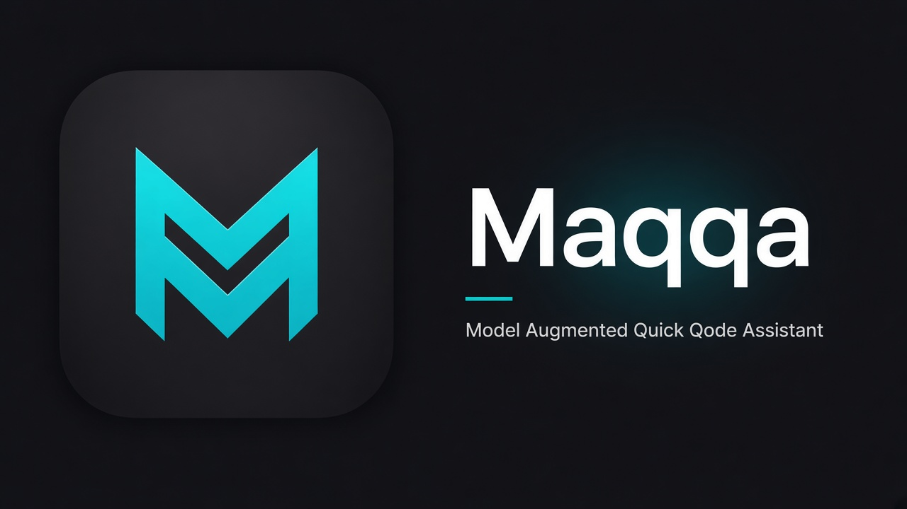
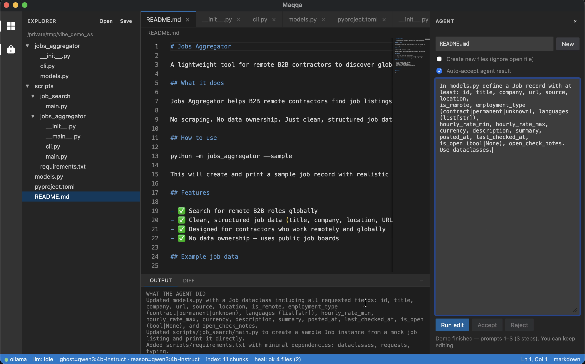

# Maqqa

[](https://github.com/maqqa-experience/maqqa/actions/workflows/ci.yml)
[](LICENSE)
[](https://maqqa.dev)

<p align="center">
  
</p>

<p align="center">
  
</p>

**Model Augmented Quick Qode Assistant** — local-first AI code editor: Tauri + Monaco UI, Rust agent engine, [Ollama](https://ollama.com) inference, Tree-sitter indexing, shadow-workspace self-heal.

> **Status:** experimental `0.1.x` preview. Useful as a research / local-agent playground on Apple Silicon. **Not** a drop-in Cursor replacement. See [`docs/STATUS.md`](docs/STATUS.md).

## Why this exists

Most agent harnesses are tuned for frontier cloud models. Point the same loops at a **local** coder (even on high-spec Apple Silicon / lots of RAM) and quality drops hard: brittle multi-file edits, weak self-correction, and prompts that assume GPT/Claude-class reasoning.

Maqqa started as a place to close that gap — a harness built **around** local Ollama models instead of treating them as a drop-in backend. Dual ghost/reason tiers, shadow-workspace heals, checkpoint repair (including temperature A/B on smaller models), and scenario benches exist so local agents can be measured and improved, not just demoed once on a 70B+ API.

## Features

- **Ghost completions** — small/fast Ollama model for inline suggestions  
- **Cmd+K / agent edits** — reason model writes through a **shadow workspace**; you Accept  
- **Self-heal** — syntax + checkpoint repair loops (optional **temperature A/B** on smaller models)  
- **Workspace index** — Tree-sitter chunks → embeddings → retrieval  
- **Scenario & bench CLIs** — multi-prompt product builds and coding benchmarks  

## Architecture

```
apps/desktop          Tauri 2 + Monaco
crates/vibe_core      agent, indexer, shadow heal, ollama, router, MCP tools
crates/vibe_ipc       shared IPC types
{workspace}/.vibe/    per-workspace runtime (shadow, index, logs) — gitignored
~/.vibe/config.toml   global model / sampling settings
```

### Dual models

| Tier | Role | Example tags |
|------|------|----------------|
| Ghost | Inline completions | `qwen2.5-coder:7b-instruct-q4_K_M` / `q8_0` |
| Reason | Cmd+K / agent / heal | `Qwen2.5-Coder:14b-instruct-q4_K_M`, `qwen3-coder:30b`, … |
| Embed | RAG | `nomic-embed-text` |

### Recommended hardware

| Machine | Reason model (Ollama) |
|---------|------------------------|
| MacBook Pro **16GB** RAM | Qwen Coder **14B** (e.g. `Qwen2.5-Coder:14b-instruct-q4_K_M`) |
| Mac mini **24GB** RAM | Qwen Coder **30B** (e.g. `qwen3-coder:30b`) |

Optional ghost (7B-class) + `nomic-embed-text`. **If RAM is tight, disable ghost** — set `ghost_model = ""` so inline completions stay off. Do **not** point ghost at a 14B+ reason model; that makes typing sluggish. Agent / Cmd+K still use `reason_model`. Enable heal temperature A/B on the 14B path (`agent_profile = "small"` / `auto`, or `ollama_heal_ab = true`).

Latency targets (aspirational on strong Apple Silicon): ghost first-token p95 **&lt;100ms**; UI paint after token **&lt;30ms**.

## Quick start

```bash
# 1) Ollama
brew install ollama   # or https://ollama.com
ollama serve

ollama pull qwen2.5-coder:7b-instruct-q4_K_M
ollama pull Qwen2.5-Coder:14b-instruct-q4_K_M   # or another reason model you can fit
ollama pull nomic-embed-text

# 2) Config
cp config.example.toml ~/.vibe/config.toml
# edit reason_model / ghost_model to match `ollama list`

# 3) Smoke the engine
cargo test -p vibe_core --lib
cargo run -p vibe_core --bin vibe_eval -- --smoke-only

# 4) Desktop
cd apps/desktop && npm install && npm run tauri dev
```

More detail: [`docs/FIRST_RUN.md`](docs/FIRST_RUN.md).

### Optional Ollama residency (Mac Studio / large RAM)

```bash
export OLLAMA_NUM_PARALLEL=2
export OLLAMA_MAX_LOADED_MODELS=2
```

## Develop

```bash
cargo check -p vibe_core
cargo test -p vibe_core --lib
cargo test -p vibe_ipc
cargo clippy -p vibe_core -p vibe_ipc --all-targets -- -D warnings

# Dual-model smoke (requires Ollama)
cargo run -p vibe_core --bin vibe_eval -- --smoke-only

# Shadow heal eval on fixtures/rust_broken
cargo run -p vibe_core --bin vibe_eval

# Multi-prompt scenario (~100 prompts → remote B2B job aggregator)
cargo run -p vibe_core --bin vibe_scenario -- --list
cargo run -p vibe_core --bin vibe_scenario -- --from 1 --to 10
# full run (long): --from 1 --to 100 --json /tmp/jobs_scenario.json

# Desktop
cd apps/desktop && npm install && npm run tauri dev

# Interactive demo (prefer Terminal.app + Screen Recording for capture)
./scripts/record_vibe_demo.sh --from 1 --to 3
```

See [`CONTRIBUTING.md`](CONTRIBUTING.md).

### Tauri commands

| Command | Purpose |
|---------|---------|
| `open_workspace` | Index folder, list files |
| `read_file` / `write_file` | Buffer I/O |
| `get_completions` / `cancel_completion` | Ghost text |
| `run_edit` | Cmd+K → reason model → shadow heal |
| `apply_edit` | Accept healed patch into live tree |
| `get_status` | Models, index size, last heal |
| `mcp_call` | Local tools: read_file, list_dir, git_*, run_terminal |

## Coding ability bench

Hand fixtures: `fixtures/coding/`. Optional large corpus from
[newfacade/LeetCodeDataset](https://github.com/newfacade/LeetCodeDataset) (MIT) via `scripts/import_leetcode.py`.

```bash
python3 scripts/import_leetcode.py --clone   # one-time
cargo run -p vibe_core --bin vibe_bench -- --source hand
cargo run -p vibe_core --bin vibe_bench -- --source lcd --split test --difficulty Easy --limit 20
```

## Agentic loop + shadow heal

Create / multi-file requests run an **agent loop** (`agent_max_turns` in config):

1. **Observe** workspace + agent-written files  
2. **Critique** against prompt intent (`DONE` / `CONTINUE`)  
3. **Act** — write/update files  
4. **Verify** / repair  
5. Repeat until done or turn budget exhausted  

Checkpoint heals can **A/B** base vs cooler sampling temperature and keep the better workspace (defaults for `agent_profile = "small"` or `auto` with reason model &lt;20B). Override with `ollama_heal_ab`.

## Config highlights

Copy [`config.example.toml`](config.example.toml) → `~/.vibe/config.toml`.

| Key | Meaning |
|-----|---------|
| `reason_model` / `ghost_model` | Ollama tags; empty `ghost_model` disables inline completions |
| `ollama_num_ctx` | Cap generate context / KV |
| `ollama_temperature` | Default sampling |
| `ollama_heal_temperature` | Cooler (or hotter) heal temp |
| `ollama_heal_ab` | `true`/`false` force; omit = follow profile / size |
| `agent_profile` | `auto` / `small` / `default` |

## Index

Tree-sitter chunks → Ollama embeddings → cosine ANN under `{workspace}/.vibe/index.db/`.

## Security

Agent runs can edit files and execute verify commands in the workspace. See [`SECURITY.md`](SECURITY.md).

## Building

Prerequisites on all platforms: **Rust stable**, **Node 20+**, and a local [Ollama](https://ollama.com) for inference (not bundled). Dev:

```bash
cd apps/desktop && npm install && npm run tauri dev
```

CLI tools (any OS):

```bash
cargo build -p vibe_core --release --bins
# → target/release/vibe_scenario, vibe_bench, vibe_eval
```

Tagging `v*.*.*` runs GitHub Actions that attach **macOS** (Apple Silicon), **Linux** (`.AppImage` / `.deb`), and **Windows** (`.msi` / NSIS) artifacts to a **draft** release. You can also run the workflows manually from the Actions tab. Local recipes below are useful for debugging.

### macOS

```bash
./scripts/build_macos_release.sh              # host arch (arm64 or Intel)
./scripts/build_macos_release.sh --universal  # arm64 + x86_64 (needs both rustup targets)
# → dist/macos/  (.app, .dmg, cli tarball)
```

Universal builds use Tauri’s `universal-apple-darwin` target (`lipo`). Unsigned preview: right-click → Open, or `xattr -cr "Maqqa.app"`.

### Linux

Install Tauri/webkit system deps (Debian/Ubuntu example):

```bash
sudo apt update
sudo apt install -y \
  libwebkit2gtk-4.1-dev libayatana-appindicator3-dev librsvg2-dev \
  patchelf libssl-dev libgtk-3-dev libsoup-3.0-dev
```

See [Tauri Linux prerequisites](https://v2.tauri.app/start/prerequisites/#linux) for Fedora/Arch packages.

```bash
cd apps/desktop
npm ci
# AppImage + .deb (omit bundles you do not need)
npx tauri build --bundles appimage,deb
# artifacts under:
#   src-tauri/target/release/bundle/appimage/
#   src-tauri/target/release/bundle/deb/
```

Also build the CLIs with `cargo build -p vibe_core --release --bins` from the repo root. Config path is still `~/.vibe/config.toml`.

### Windows

1. Install [Build Tools for Visual Studio](https://visualstudio.microsoft.com/visual-cpp-build-tools/) (C++ workload) and the [WebView2 runtime](https://developer.microsoft.com/microsoft-edge/webview2/) (usually present on Win10/11).
2. Install Rust (`rustup`) and Node 20+.

In **PowerShell** or **Developer Command Prompt**:

```powershell
cd apps\desktop
npm ci
npx tauri build --bundles msi,nsis
# artifacts under:
#   src-tauri\target\release\bundle\msi\
#   src-tauri\target\release\bundle\nsis\
```

CLIs:

```powershell
cargo build -p vibe_core --release --bins
```

User config: `%USERPROFILE%\.vibe\config.toml` (same keys as `config.example.toml`).

## License

[MIT](LICENSE)
